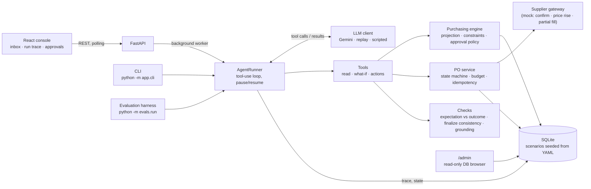
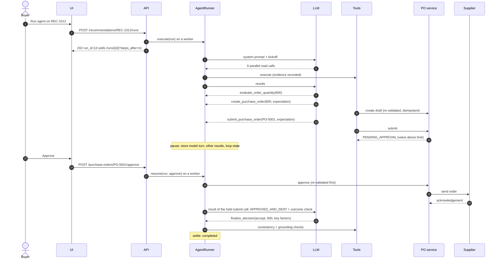
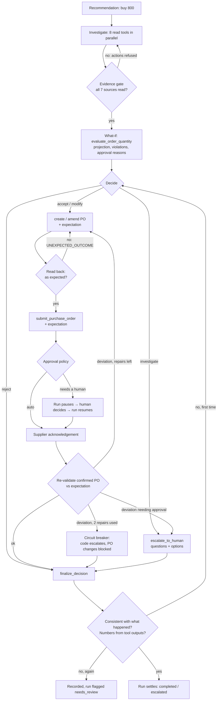
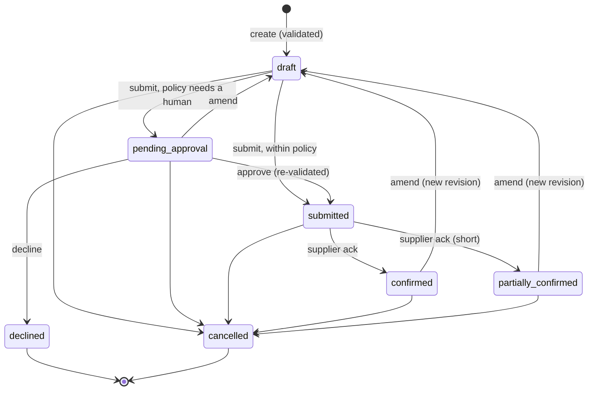

# Architecture

One FastAPI process serves the API, runs agent runs on background workers and talks to a
SQLite database. A React app is the buyer's console. The LLM sits inside a loop whose every
side effect goes through deterministic code.

## Components

| Layer | Code | Responsibility |
|---|---|---|
| Engine | `backend/app/engine/` | Pure functions: inventory position, day-by-day projection, order rounding, constraint findings, approval policy, rules-only reference decision. No I/O, no LLM. |
| Services | `backend/app/services/` | Build the engine's snapshot from the DB; the PO lifecycle; the supplier gateway. |
| Agent | `backend/app/agent/` | LLM clients, tools, prompt, the orchestrator loop and the checks that close the feedback loop. |
| API | `backend/app/api/` | Recommendations, runs, approvals, escalations, POs, demo reset. |
| Evaluation | `backend/evals/` | Harness, graders, golden trajectories, reports. |
| UI | `frontend/src/` | Inbox, live run trace, approval panel, approvals queue. |

## One run, end to end

## The feedback loop

## Purchase order states

Budget is committed when a PO is sent, adjusted to what the supplier confirms (even past the
budget, so re-validation sees the truth) and released on amend or cancel. Every transition is
written to `purchase_order_events`.

## Data

SQLite (WAL mode) with SQLAlchemy 2. Tables: products, nodes, suppliers, supplier terms,
inventory, daily forecasts, sales history, budgets, purchase orders and their events,
recommendations, agent runs, agent steps (the trace) and escalations. All dates come from a
fixed simulated clock (`SIM_TODAY`), so scenarios are reproducible. The schema carries a
version stamp; a database from an older version is rebuilt from the scenario files on start
(demo data only; production would use migrations).

Scenarios live in `backend/scenarios/*.yaml`: one baseline world where buying 800 is exactly
right, and 14 files that each override one thing and state the hand-labelled expected outcome.
